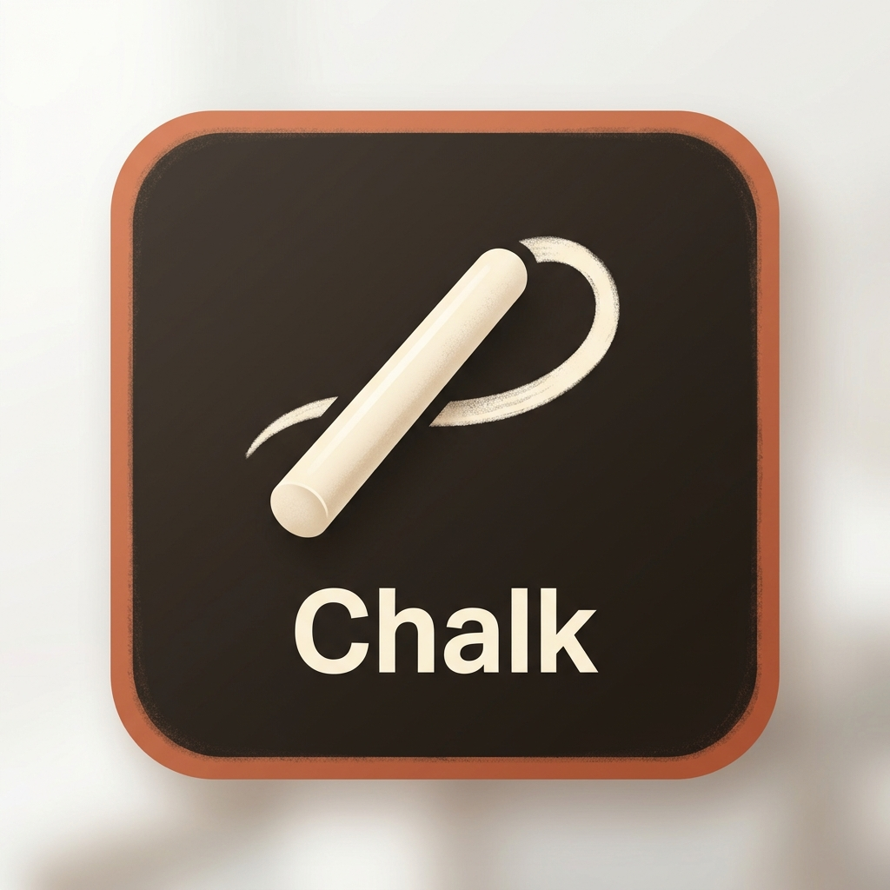
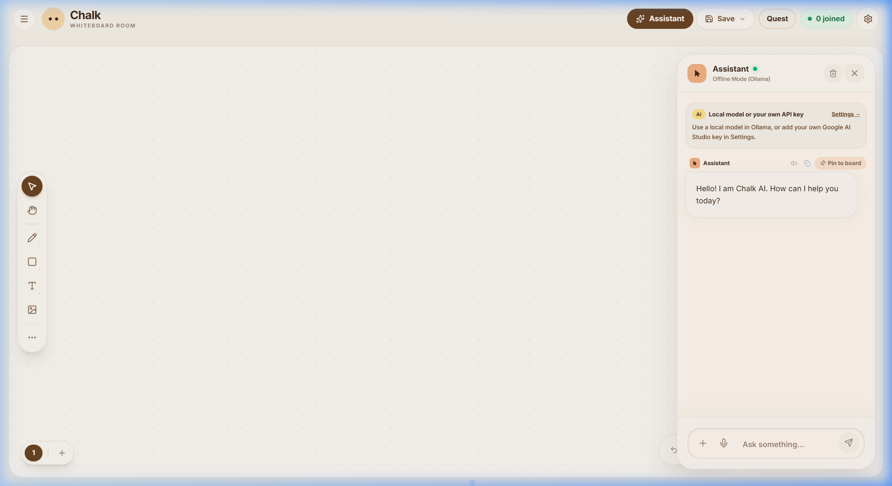
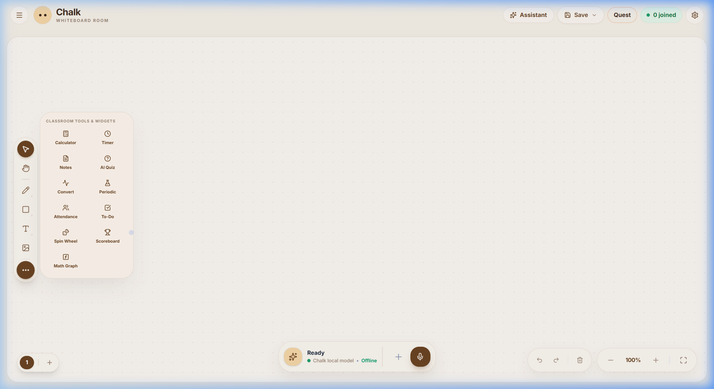
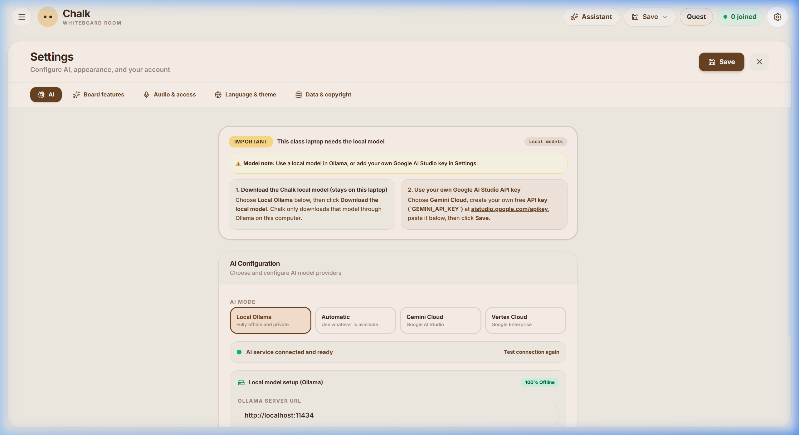
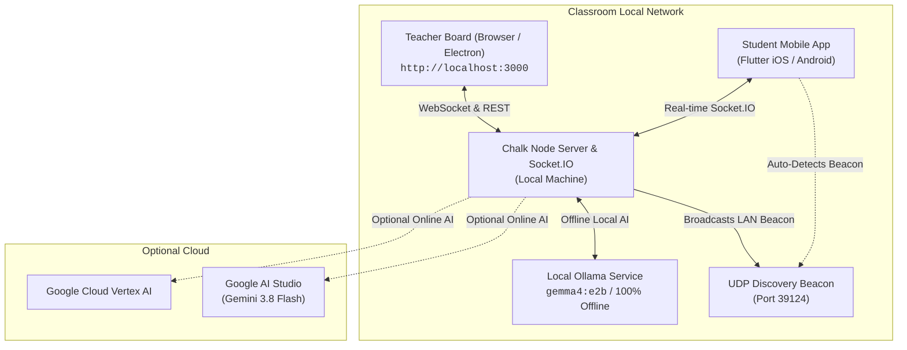

<p align="center">
  
</p>

<h1 align="center">Chalk</h1>

<p align="center">
  <strong>Intelligent Classroom Whiteboard & Real-Time Collaborative Learning Space</strong>
</p>

<p align="center">
  <a href="#key-features">Key Features</a> •
  <a href="#visual-tour">Visual Tour</a> •
  <a href="#installation--getting-started">Installation</a> •
  <a href="#project-structure">Project Structure</a> •
  <a href="#offline-first-architecture">Offline Architecture</a> •
  <a href="#scripts--verification">Scripts</a>
</p>

<p align="center">
  
  
  
  
  
  
  
</p>

---

## Overview

**Chalk** is a modern, privacy-first whiteboard designed specifically for teachers and students. It unites a high-performance infinite digital chalkboard, an integrated classroom voice/text AI assistant, an embedded suite of interactive teaching widgets, and a zero-latency local classroom network that connects student mobile devices without needing internet connectivity.

Teachers run Chalk on a laptop or interactive classroom display, while students join directly from their phones via local Wi-Fi or LAN to follow along, ask questions silently, and participate in live quizzes.

---

## Visual Tour

### 1. Minimalist Interactive Whiteboard
A clean, warm chalk-styled workspace with zero clutter. Includes pen with pressure curves, smooth eraser, geometric shape recognition, rich typography, images, and multi-page notebooks.

<p align="center">
  
</p>

---

### 2. Integrated Classroom AI Assistant
Instant voice and text assistance directly beside your notes. Ask for step-by-step problem explanations, quiz formulations, diagram ideas, or pin AI responses directly onto the whiteboard canvas as visual notes. Supports 100% offline local inference (Gemma via Ollama) and cloud inference (Gemini 3.8 Flash).

<p align="center">
  
</p>

---

### 3. Live Quests & Student Engagement
Launch gamified live quests and interactive quizzes straight from your lesson board. Students respond directly from their phones, giving you real-time response tallies, scoreboards, and silent questions from shy students.

<p align="center">
  
</p>

---

### 4. Interactive Classroom Tools & Widget Palette
Access a comprehensive toolset built into the left toolbar: scientific calculator, countdown timers, sticky notes, unit converter, dynamic periodic table, student attendance manager, random spin wheel, scoreboards, and mathematical function graphers.

<p align="center">
  
</p>

---

### 5. Multi-Provider AI & Offline-First Privacy
Seamlessly toggle between **Local Ollama** (100% offline, zero data leaves the classroom laptop), **Google AI Studio** (`GEMINI_API_KEY`), and **Google Cloud Vertex AI**. Auto-detection falls back gracefully based on classroom network availability.

<p align="center">
  
</p>

---

### 6. Session Persistence & High-Res Export
One-click saving to laptop IndexedDB with undo/redo history. Export your lesson boards to vector SVG, 1x/2x/4K Ultra-HD PNG, or multi-page A4 PDF handouts for your students.

<p align="center">
  
</p>

---

## Key Features

- **Infinite Canvas & Smooth Strokes**: Low-latency freehand vector drawing powered by `perfect-freehand` with variable pressure curves and eraser paths.
- **Offline-First & Privacy Guaranteed**: Run completely offline without internet using Ollama (`chalk-gemma:2b` / `gemma4:e2b`).
- **Student Mobile Companion**: Cross-platform Flutter mobile client allowing students to view lesson notes in real time, answer questions, and submit silent inquiries.
- **LAN Discovery & UDP Beacon**: Built-in broadcast beacon (`CLASS_BEACON_PORT: 39124`) automatically advertises active classes on the school subnet so students can join with a simple 4-digit room code.
- **Interactive Teaching Widgets**: Calculator, Stopwatch/Timer, Spin Wheel, Attendance, Periodic Table, To-Do, and Math Graph.
- **Multi-Format Export**: PNG (1x, 2x, 4K), SVG, and printable multi-page A4 PDF documents.
- **Desktop Electron Bundle**: Ready to package as a standalone Windows, macOS, or Linux desktop application.

---

## Installation & Getting Started

### Prerequisites

- **Node.js**: `v22.x LTS` or higher
- **npm**: `v10.x` or higher
- *(Optional for offline AI)*: [Ollama](https://ollama.ai) installed with `gemma` models
- *(Optional for mobile app)*: [Flutter SDK](https://flutter.dev) (only needed if building the student app)

### 1. Clone & Install Dependencies

```bash
git clone https://github.com/DevRanbir/Chalk.git
cd Chalk
npm install
```

### 2. Configure Environment Variables

Chalk works out-of-the-box in local offline mode without any configuration. To enable cloud Gemini or Vertex AI, create a `.env` file:

```bash
cp .env.example .env
```

Edit `.env` to specify your preferred settings:

```ini
# Server Configuration
SERVER_PORT=3000
NODE_ENV=development

# Optional Cloud AI (Google AI Studio)
GEMINI_API_KEY=your_gemini_api_key_here

# Optional Vertex AI Configuration
# GOOGLE_CLOUD_PROJECT=your-gcp-project-id
# GOOGLE_APPLICATION_CREDENTIALS=/path/to/credentials.json

# Local Ollama URL (default: http://localhost:11434)
# OLLAMA_BASE_URL=http://localhost:11434
```

### 3. Run the Development Server

```bash
npm run dev
```

Visit **`http://localhost:3000`** in your browser. Chalk will start with the teacher whiteboard active.

---

## Running the Student Companion App

The student companion application is located under the `student/` directory and built with Flutter:

```bash
cd student
flutter pub get
flutter run
```

Students connect by entering the 4-digit classroom code displayed on the teacher's board.

---

## Project Structure

```text
Chalk/
├── api/                   # Vercel serverless AI endpoints (fallback & cloud)
│   └── ai/                # generate, status, transcribe, pull-model handlers
├── components/            # React UI components for the whiteboard & tools
│   ├── AiChatDrawer.tsx   # Classroom AI assistant sidebar
│   ├── AiStatusBadge.tsx  # Dynamic AI health and connectivity pill
│   ├── CanvasManager.tsx  # Core whiteboard canvas renderer & stroke engine
│   ├── ClassroomTools.tsx # Interactive widgets (Calculator, Timer, Periodic Table)
│   ├── ExportDialog.tsx   # PDF, PNG, and SVG high-res export interface
│   ├── Header.tsx         # Top application header with room info & quick actions
│   ├── QuestDialog.tsx    # Live gamified student quiz modal
│   └── SettingsView.tsx   # AI provider, theme, audio, and language configuration
├── docs/                  # Comprehensive documentation & asset guides
│   ├── screenshots/       # High-resolution application screenshots
│   ├── API_DOCUMENTATION.md
│   ├── TEACHER_GUIDE.md
│   └── USAGE.md
├── electron/              # Electron main process & desktop runtime wrappers
├── hooks/                 # Custom React hooks (AI status polling, canvas sync, audio)
├── public/                # Static assets, web manifests, PWA icons
├── server/                # Express & Socket.io backend services
│   ├── aiRouter.ts        # Modular REST API endpoints for AI orchestration
│   ├── geminiAdapter.ts   # Google AI Studio Gemini SDK adapter
│   ├── ollamaAdapter.ts   # Local Ollama adapter with streaming & cancel tokens
│   ├── vertexAdapter.ts   # Google Cloud Vertex AI enterprise adapter
│   └── classAnswer.ts     # Automated Q&A synthesis for student asks
├── student/               # Flutter mobile application for students
├── tests/                 # Unit & integration test suites (Vitest + Testing Library)
├── constants.ts           # Centralized system constants, default models, and timeouts
├── server.ts              # Primary classroom HTTP, WebSocket, and UDP beacon server
├── store.ts               # Zustand global state (canvas pages, chat, active tools)
└── types.ts               # Complete TypeScript interface & schema definitions
```

---

## Offline-First Architecture



---

## Scripts & Verification

All standard workflow scripts can be run via `npm`:

| Command | Description |
| :--- | :--- |
| `npm run dev` | Starts server with live auto-reloading (`tsx watch server.ts`) |
| `npm start` | Runs production server with tsx runtime |
| `npm run check` | Runs fast zero-thrash TypeScript type check (`tsc --noEmit`) |
| `npm test` | Runs automated unit and integration tests with Vitest |
| `npm run build` | Compiles frontend client assets via Vite |
| `npm run build:all` | Compiles frontend client and backend TypeScript bundles |
| `npm run electron:dev` | Launches the Chalk desktop app in local Electron runtime |
| `npm run build:electron:win` | Packages standalone Windows `.exe` installer (NSIS) |

---

## Contributing

Contributions, bug reports, and suggestions are warmly welcomed! Please read our [Contributing Guide](CONTRIBUTING.md) and check [open issues](https://github.com/DevRanbir/Chalk/issues).

---

## License

Chalk is open-source software licensed under the **[MIT License](LICENSE)**.